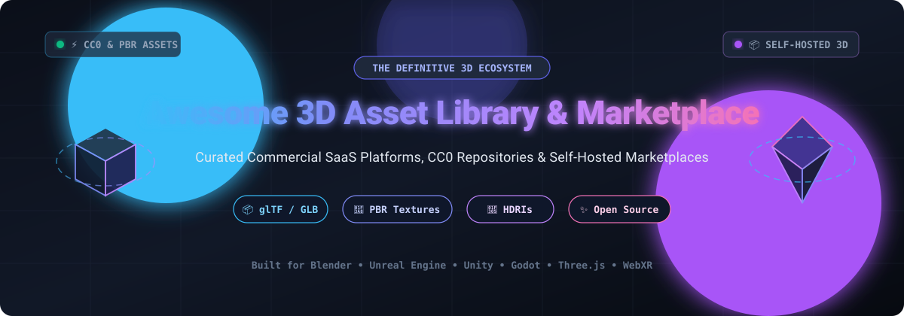

  

# 🎮 Awesome 3D Asset Library & Marketplace

  
  
  
  

> 🌟 A curated directory of premier **3D asset libraries**, **3D model marketplaces**, **PBR texture repositories**, and **open-source self-hosted 3D platforms** for game developers, VFX artists, indie creators, and 3D web engineers.

Explore top commercial SaaS platforms alongside community-driven, open-source 3D asset hubs. Whether you need free CC0 models, photogrammetry scans, HDRIs, game-ready assets, or self-hosted marketplace software, this guide covers the entire modern 3D ecosystem.

---

## 📑 Table of Contents

- [🌐 Sector Overview & Market Dynamics](#-sector-overview--market-dynamics)
- [🏢 SaaS & Commercial 3D Asset Marketplaces](#-saas--commercial-3d-asset-marketplaces)
- [🔓 Open-Source 3D Asset Libraries & Repositories](#-open-source-3d-asset-libraries--repositories)
  - [⭐ Featured Open-Source Projects](#-featured-open-source-projects)
  - [🛠️ Additional Open-Source Repositories & Tools](#️-additional-open-source-repositories--tools)
- [📐 3D Asset Types & Formats Reference](#-3d-asset-types--formats-reference)
- [🤝 How to Contribute](#-how-to-contribute)
- [💖 Support](#-support)
- [📈 Star History](#-star-history)
- [📜 License & Disclaimer](#-license--disclaimer)

---

## 🌐 Sector Overview & Market Dynamics

The global 3D digital asset and modeling market is estimated between **$26 billion and $33 billion**, accelerating at a compound annual growth rate (CAGR) of **12.8% to 13.6%** driven by real-time rendering, virtual production, digital twins, and immersive gaming. 

The sector exhibits **high fragmentation** at the supply and marketplace tier—with thousands of independent artists, specialized boutiques, and open-source communities hosting assets across decentralized platforms—while engine developers and creative software conglomerates (**Adobe, Epic Games, Shutterstock, Unity**) exert centralizing force through acquisitions, proprietary marketplace ecosystems, and native DCC tool integrations.

---

## 🏢 SaaS & Commercial 3D Asset Marketplaces

The following SaaS platforms provide hosted asset management, browser-based 3D previews, and massive catalogs of 3D models, PBR textures, and HDRIs. 

*The table is sorted in descending order by parent company size (market valuation / revenue scale).*

| Product | Company Scale (Valuation / Revenue) | Description | Pricing | Free Tier Limit |
| :--- | :--- | :--- | :--- | :--- |
| **[Adobe Substance 3D Assets](https://www.adobe.com/products/substance3d/3d-assets.html)** | **~$105 Billion** (Public Market Cap, Adobe NASDAQ: ADBE) | Thousands of professional-grade parametric materials, models, and HDRIs integrated into Adobe's creative suite. | **Substance 3D Collection**: $49.99/month (includes 30 asset downloads/month); **Texturing Plan**: $19.99/month. | **30-day free trial** of Substance 3D Collection with full app suite access; rotating collection of free public sample assets on the Substance 3D Community platform. |
| **[Quixel Megascans](https://quixel.com/megascans)** | **~$22.5 Billion** (Private Valuation, Parent: Epic Games) | The world's largest photogrammetry 2D/3D scan library with calibrated PBR surfaces, 3D vegetation, and modular kits. | **Free** for all Unreal Engine projects. Outside UE: Fab personal standard license starts from $19/seat or per-pack licensing. | **100% Free forever** for Unreal Engine rendering and game projects with unlimited asset downloads; no time restrictions. |
| **[Sketchfab Store](https://sketchfab.com/store)** | **~$22.5 Billion** (Subsidiary of Epic Games) | Real-time 3D model marketplace with interactive WebGL/WebXR browser inspection and AR/VR viewer. | Free account to browse; commercial purchases start at $3.00/model. **Sketchfab Pro** for creators is $15/month ($180/year billed annually). | **Free forever plan**: unlimited public 3D uploads (up to 100MB per model), 10 private uploads per month, and unlimited free-license model downloads. |
| **[ArtStation Marketplace](https://www.artstation.com/marketplace)** | **~$22.5 Billion** (Subsidiary of Epic Games) | Digital marketplace for brushes, alphas, base meshes, tutorials, and game-ready 3D props by professional concept artists. | Individual purchases starting at $1.00/asset. **ArtStation Plus** membership starts at $9.95/month; **Pro** at $14.95/month. | **Free forever account**: free portfolio hosting, community browsing, and unlimited access to all assets tagged as free by creators ($0 downloads). |
| **[TurboSquid](https://www.turbosquid.com/)** | **~$170 Million** (Public Market Cap, Parent: Shutterstock NYSE: SSTK) | Major commercial 3D model marketplace with millions of checkmate-certified models across automotive, characters, and architecture. | Individual model purchases starting from $5.00/asset up to $500+. Enterprise **PixelSquid** subscription starts at $19.99/month. | **Free forever account**: access to 50,000+ free downloadable models filterable via search; no free trial period for paid models. |
| **[CGTrader](https://www.cgtrader.com/)** | **~$50 Million** (Privately held venture-backed; ~$15M+ ARR) | Massive 3D marketplace for computer graphics, game development, 3D printing (STL), and interactive AR/VR assets. | Asset purchases starting from $2.00/model. **CGTrader Enterprise AR/3D DAM** starts from $199/month. | **Free forever account**: unrestricted access to download over 150,000 free 3D models and print files; no subscription required to buy or download free assets. |
| **[KitBash3D](https://kitbash3d.com/)** | **~$25 Million** (Privately held studio tech scale) | Premium themed 3D environment kits designed for Hollywood films, AAA game studios, and concept artists. | **Individual kits**: $99.00 to $199.00 per kit. **Cargo Pro**: $65/month ($780/year billed annually); **Cargo Teams**: $119/month per seat. | **Free forever Cargo tier**: 100% free access to 100+ basic building meshes, modular props, and PBR materials with 1-click DCC import plugins. |
| **[Poliigon](https://www.poliigon.com/)** | **~$15 Million** (Privately held; independent studio scale) | High-quality photorealistic PBR textures, 3D models, brushes, and HDRIs with native Blender, 3ds Max, Maya, and Cinema 4D addons. | **Individual plan**: $18/month (billed monthly) or $14/month (billed annually, 100 credits/month). **Studio**: $36/month. | **7-day free trial** with access to sample downloads; persistent free forever tier providing 80+ completely free PBR materials and textures upon account creation. |
| **[Blend Swap](https://blendswap.com/)** | **~$1 Million** (Bootstrapped community-operated marketplace) | Long-standing community repository dedicated to sharing open Blender `.blend` files under Creative Commons licenses. | Basic membership is **$0**. Supporter plans: **Associate** at $4.00/month; **Fellow** at $10.00/month for unlimited bandwidth. | **Free forever account**: maximum of 20 downloads per month with standard download queues; unlimited browsing and file sharing. |

---

## 🔓 Open-Source 3D Asset Libraries & Repositories

Explore open-source 3D solutions, CC0 public domain repositories, procedural texture authors, and self-hostable 3D asset engines.

*The projects below are sorted in descending order by GitHub stargazers count.*

### ⭐ Featured Open-Source Projects

1. **[glTF](https://github.com/KhronosGroup/glTF)**   
   **The 3D runtime asset delivery standard (~7,869 stars).** The official specification, JSON schema, and ecosystem documentation for glTF 2.0 (the "JPEG of 3D"). Governed by the Khronos Group, it defines the transmission standard for models, materials (PBR), animations, and morph targets across WebGL, WebXR, Unreal Engine, Unity, Godot, and Three.js.

2. **[NASA 3D Resources](https://github.com/nasa/NASA-3D-Resources)**   
   **NASA's public domain 3D model and texture repository (~3,831 stars).** An extensive open repository containing spacecraft, lunar landing modules, asteroids, astronauts, and celestial terrain models directly from NASA missions. All models are open-access and free for public, academic, and commercial application.

3. **[glTF Sample Models](https://github.com/KhronosGroupArchives/glTF-Sample-Models)**   
   **Khronos Group's reference 3D model library (~3,611 stars).** Comprehensive canonical collection of glTF 2.0 and GLB models designed for testing engine rendering fidelity, PBR material extensions (Clearcoat, Transmission, Sheen, Volume), and procedural animations.

4. **[Poly Haven Assets](https://github.com/Poly-Haven/polyhavenassets)**   
   **The CC0 public asset gold standard (~532 stars).** Code, metadata schemas, and tools powering [Poly Haven](https://polyhaven.com/)—the premier community library of 16K HDRIs, 8K PBR photogrammetry surfaces, and realistic 3D models. **100% CC0 (Public Domain)**, usable freely for any purpose without licensing restrictions, attribution requirements, or paywalls.

5. **[BlenderKit](https://github.com/BlenderKit/Blendkit)**   
   **In-viewport 3D asset library for Blender (~283 stars).** Open-source Blender extension providing access to thousands of community models, materials, brushes, and HDRIs directly within Blender's 3D viewport. Includes drag-and-drop mechanics, automated license tracking, and search filtering.

6. **[open-source-3D-assets](https://github.com/ToxSam/open-source-3D-assets)**   
   **Structured CC0 3D metaverse asset registry (~170 stars).** Curated, API-friendly registry and metadata directory indexing 990+ CC0-licensed GLB models, avatars, and interactive items tailored for WebGL games, metaverse worlds, and automated 3D asset pipelines.

7. **[Polydown](https://github.com/agmmnn/polydown)**   
   **Automated command-line 3D asset downloader (~107 stars).** Fast CLI utility for batch downloading high-resolution HDRIs, textures, and 3D models from Poly Haven with customizable resolution limits, format targets, and folder organization.

8. **[Icosa Gallery](https://github.com/icosa-foundation/icosa-gallery)**   
   **Open-source successor to Google Poly (~31 stars).** Apache 2.0 licensed web platform for hosting, displaying, and distributing interactive 3D assets and VR content. Developed by the Icosa Foundation (creators of Open Brush) with WebGL embedding, model conversion, and Godot/Blender API integrations.

9. **[3Dēx](https://github.com/Schryzon/3Dex)**   
   **AI-assisted 3D asset marketplace & print platform (~5 stars).** Full-stack web application connecting 3D creators, buyers, and print manufacturers. Built with **Next.js, Node.js, PostgreSQL, MinIO, and pgvector**, featuring WebGL model inspection, vector semantic search, and creator dashboards.

10. **[3D RGB (3DMeta-Shop)](https://github.com/iranpsc/3DMeta-Shop-Object-3D)**   
    **Self-hosted 3D marketplace engine (~2 stars).** Production-ready eCommerce web platform for selling 3D models, game characters, textures, and digital renders. Built with **Laravel, Blade, and Tailwind CSS**, featuring shopping carts, customer download portals, and role-based access control.

---

### 🛠️ Additional Open-Source Repositories & Tools

- **[Material Maker](https://github.com/RodZill4/material-maker)**  — Procedural PBR texture authoring and 3D model painting suite built on Godot engine (~6,016 stars).
- **[Model-Viewer](https://github.com/google/model-viewer)**  — Google's web component for rendering interactive 3D models and AR on the web (~8,291 stars).
- **[Online 3D Viewer](https://github.com/kovacsv/Online3DViewer)**  — Zero-dependency web solution to inspect 3D files (glTF, OBJ, STL, 3DS, FBX, DXF) in browsers (~3,737 stars).
- **[M3 CharacterStudio](https://github.com/M3-org/CharacterStudio)**  — Open-source web-based customizable VRM 3D avatar creator and asset pipeline (~115 stars).
- **[ambientCG Importer](https://github.com/z3lx/acg-importer)**  — Unity editor tool to download and import CC0 PBR textures and materials directly from ambientCG into Unity projects (~17 stars).

---

## 📐 3D Asset Types & Formats Reference

When choosing an asset library or building a pipeline, format interoperability is critical:

| Format | File Extension | Key Use Case | Target Engines & Toolsets |
| :--- | :--- | :--- | :--- |
| **glTF / GLB** | `.gltf`, `.glb` | Standard runtime transmission format for WebGL, WebXR, and real-time engines | Three.js, Babylon.js, Godot, Unreal Engine, Unity |
| **USD / USDZ** | `.usd`, `.usdz`, `.usda` | Universal Scene Description for VFX pipelines and Apple iOS AR Quick Look | Blender, Maya, Houdini, Omniverse, iOS AR |
| **FBX** | `.fbx` | De facto industry standard for skinned meshes, skeletal rigs, and animations | Unreal Engine, Unity, Autodesk Maya, 3ds Max, Blender |
| **OBJ + MTL** | `.obj`, `.mtl` | Universal legacy static polygonal mesh format | Compatible across virtually all 3D software |
| **EXR / HDR** | `.exr`, `.hdr` | 32-bit floating point high dynamic range environment lighting maps | Blender, Unreal Engine, Unity, Arnold, V-Ray, Octane |

---

## 🤝 How to Contribute

Contributions are warmly welcome! Help make this ecosystem resource better:

1. 🍴 **Fork** this repository.
2. 📝 **Edit** [README.md](file:///C:/Users/ishan/Documents/Projects/Awesome-3D-Asset-Library-Marketplace/README.md) following the established table structure and Markdown conventions.
3. 💼 Ensure all new **SaaS entries** include specific **Company Scale**, **Pricing**, and **Free Tier Limit** details.
4. ⭐ Ensure all new **Open-Source entries** include their stargazers count badge with `style=social&color=white` linked to `/stargazers`.
5. 🚀 **Submit a Pull Request** with a concise description of your additions.

---

## 💖 Support

A huge thank you to everyone in the open-source 3D, gaming, and VFX community for sharing knowledge, models, and tools! 🎉

If you find this directory valuable:
- ⭐ **Star** this repository on GitHub.
- 🍴 **Fork** and share it with your fellow 3D artists and developers.
- ☕ Consider buying a coffee or becoming a sponsor via the [GitHub Sponsor Dashboard](https://github.com/sponsors/ishandutta2007)!

---

## 📈 Star History

---

## 📜 License & Disclaimer

- 📖 **Curated Content**: This list is community-curated for informational purposes and does not represent direct commercial endorsement.
- ⚖️ **Licensing Compliance**: Always verify individual model and texture licenses before commercial use (e.g., CC0 Public Domain vs. CC-BY Attribution vs. Royalty-Free Commercial).
- 🖥️ **Self-Hosting**: Self-hosted marketplace solutions require suitable server infrastructure, database setups, and cloud asset storage (e.g., AWS S3, MinIO).

Distributed under the [MIT License](LICENSE).
